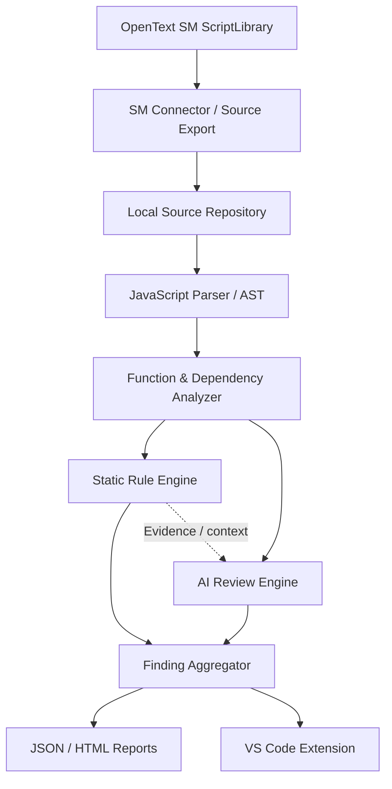

# Kế hoạch phát triển SM ScriptLibrary Code Reviewer

> **Dự án:** SM ScriptLibrary Reviewer  
> **Nền tảng mục tiêu:** OpenText / HPE Service Manager (SM 9.8x)  
> **Thời lượng dự kiến:** 6 sprint × 2 tuần = 12 tuần  
> **Repository:** https://github.com/hao2000ln/sm-script-reviewer

Tài liệu liên quan: [`README.md`](../README.md), [`AGENTS.md`](../AGENTS.md) và các quyết định kiến trúc trong [`docs/decisions/`](decisions/).

Thời lượng trên là ước tính lập kế hoạch, có thể thay đổi theo kết quả review, mức độ sẵn có của tài liệu SM và UAT trên source đại diện.

## 1. Mục đích dự án

Xây dựng một **công cụ độc lập để tự động kiểm tra, đánh giá và nâng cao chất lượng mã nguồn ScriptLibrary** trên OpenText/HPE Service Manager.

### 1.1. Vấn đề cần giải quyết

- Chất lượng code không đồng nhất giữa các developer và module.
- Code review thủ công, khó phát hiện đầy đủ lỗi logic.
- Thiếu công cụ phát hiện vòng lặp vô hạn, lỗi xử lý `SCFile`, return code và tài nguyên.
- Tồn tại code debug/test, comment không đúng chuẩn và code dư thừa.
- Khó đánh giá quan hệ phụ thuộc giữa các ScriptLibrary.
- Chưa có quy trình kiểm tra chất lượng code thống nhất.

### 1.2. Năm câu hỏi công cụ cần trả lời

1. **Code có lỗi gì?** Phát hiện lỗi cú pháp, logic và cách sử dụng API SM.
2. **Code có tuân thủ tiêu chuẩn không?** Kiểm tra comment, naming convention và cấu trúc.
3. **Code có rủi ro gì?** Phát hiện vòng lặp vô hạn, lỗi truy vấn, tài nguyên và hiệu năng.
4. **Code có thể cải thiện thế nào?** Giải thích vấn đề và đề xuất refactor.
5. **Chất lượng code hiện tại ra sao?** Tổng hợp findings theo script, module và mức độ nghiêm trọng.

**Nguyên tắc:** Công cụ chỉ đọc và phân tích source, không tự động sửa code trên môi trường SM.

## 2. Kiến trúc tổng thể

**Nguyên tắc kiến trúc:** Static Rule Engine là nền tảng chính; AI hỗ trợ phân tích logic và ngữ nghĩa phức tạp, không thay thế những kiểm tra có thể xác định bằng thuật toán. Runtime JavaScript trong SM khác Node.js; công cụ reviewer dùng TypeScript/Node.js nhưng không áp đặt giả định Node.js lên source SM.

## 3. Kế hoạch triển khai theo sprint

| Sprint | Thời lượng | Trọng tâm | Trạng thái |
|---|---|---|---|
| 1 | 2 tuần | Core Foundation & Parser | Hoàn tất và đã merge |
| 2 | 2 tuần | Static Rule Engine | Hoàn tất và đã merge |
| 3 | 2 tuần | SM-Specific Rules & Reports | Phase B hoàn tất local, chờ independent review |
| 4 | 2 tuần | AI Review Engine | Chưa bắt đầu |
| 5 | 2 tuần | VS Code Extension | Chưa bắt đầu |
| 6 | 2 tuần | SM Connector & UAT | Chưa bắt đầu |

### Sprint 1 — Core Foundation & Parser

**Mục tiêu:** Xây dựng nền tảng đọc và phân tích cấu trúc ScriptLibrary.

**Phạm vi:**
- Khởi tạo TypeScript/Node.js project và CLI.
- Source Loader đọc file `.js`.
- Parser tạo AST.
- Function Indexer nhận diện các dạng function.
- Comment Indexer xác định comment thuộc function.
- Chuẩn hóa source location.
- Xử lý parse diagnostics và regression tests.

**Tiến độ:** Phase A Audit và Phase B implementation đã hoàn tất local, bao gồm các regression case bổ sung sau independent review. [PR #1](https://github.com/hao2000ln/sm-script-reviewer/pull/1) cần được người quản lý dự án cập nhật, sau đó ChatGPT review lại trước khi nghiệm thu hoặc merge. Mẫu `examples/sample.js` chỉ là smoke-test fixture, chưa thay thế validation trên source SM thực tế.

**Đầu ra:** Parser ổn định làm nền tảng cho các static rules.

**Tiêu chí hoàn thành:**
- Public parser contract và mọi thay đổi schema được tài liệu hóa.
- Function/comment indexing có positive, negative và boundary regression tests.
- Parse diagnostics không làm analyzer crash; giới hạn recovery được ghi rõ.
- `npm test` và CLI text/JSON smoke tests chạy thành công.
- Parser được kiểm tra với source SM đại diện trước khi tuyên bố coverage hoàn chỉnh.

### Sprint 2 — Static Rule Engine

**Mục tiêu:** Xây dựng hệ thống kiểm tra code theo bộ quy tắc.

**Phạm vi:**
- Rule Registry và Rule Runner.
- Cấu hình bật/tắt rule.
- Phát hiện function thiếu comment.
- Phát hiện `print()` debug/test.
- Nhận diện code bị comment hoặc comment không cần thiết dưới dạng heuristic finding có confidence.
- Phát hiện các trường hợp unreachable code chứng minh được bằng control-flow analysis.
- Phát hiện cú pháp vòng lặp vô điều kiện không có exit được nhận diện; đây là kiểm tra cú pháp deterministic, không phải bằng chứng chắc chắn rằng runtime sẽ chạy vô hạn.

**Đầu ra:** Engine trả về findings gồm lỗi, vị trí, mức độ và đề xuất xử lý.

**Tiến độ:** Rule Engine foundation, control-flow và heuristic rules đã hoàn tất và merge. Regression và acceptance tests của Sprint 2 tiếp tục được chạy trong Sprint 3.

**Tiêu chí hoàn thành:**
- Có contract ổn định cho `Rule`, `RuleContext`, `Finding`, severity và source range.
- Rule Registry chạy được tập rule đã bật và không phụ thuộc CLI/report renderer.
- Cấu hình bật/tắt rule có validation và hành vi lỗi rõ ràng.
- Mỗi rule có positive, negative và boundary tests; heuristic findings phải có confidence hoặc nhãn uncertainty.
- Kết quả rule có evidence và source location tái lập được.

### Sprint 3 — SM-Specific Rules & Reporting

**Mục tiêu:** Phân tích lỗi đặc thù OpenText SM.

**Phạm vi:**
- Kiểm tra `SCFile`, `doSelect()` và `getNext()` theo API contract đã xác minh. Chỉ kiểm tra `doClose()` khi có tài liệu hoặc project evidence xác nhận lifecycle contract.
- Kiểm tra return code.
- Phát hiện vòng lặp không cập nhật điều kiện.
- Phát hiện rủi ro trong SM query expressions; chỉ kiểm tra SQL đối với API hoặc custom integration đã được xác minh thực sự sử dụng SQL.
- Review nhiều ScriptLibrary cùng lúc.
- Xuất JSON/HTML report.

**Đầu ra:** **MVP** có thể review ScriptLibrary offline mà không cần AI hoặc kết nối trực tiếp SM.

**Tiến độ:** Phase A architecture/evidence audit đã được review. Phase B đã hoàn tất local với evidence-backed SCFile catalog, event extraction, direct/one-hop symbol tracking, bounded intraprocedural flow, `SM-RC-001` và `SM-LOOP-002`. Phase C CLI/reporting chưa bắt đầu.

**Tiêu chí hoàn thành:**
- SM-specific rules dựa trên tài liệu hoặc source mẫu đã được xác minh, không suy đoán semantics.
- Có fixtures cho lifecycle `SCFile`, return codes, query expressions và loop-update patterns.
- Batch review cô lập lỗi theo file và tạo kết quả ổn định cho cùng một input.
- JSON schema được tài liệu hóa; HTML report thể hiện đúng evidence, severity và source location.
- Một luồng offline end-to-end chạy thành công trên bộ ScriptLibrary đại diện.

### Sprint 4 — AI Review Engine

**Mục tiêu:** Bổ sung AI để phân tích vấn đề khó phát hiện bằng static rules.

**Phạm vi:**
- Tích hợp AI Provider.
- Xây dựng Knowledge Base có nguồn, phiên bản và khả năng truy vết cho SM runtime.
- Phân tích logic nghiệp vụ và dependency.
- Đánh giá chất lượng comment và cấu trúc function.
- Đề xuất cải thiện code.
- Kiểm tra bằng chứng và loại bỏ findings trùng lặp.

**Đầu ra:** Review kết hợp Static Analysis + AI.

**Tiêu chí hoàn thành:**
- AI nhận source context, dependency context và static findings có cấu trúc.
- Mọi AI finding có evidence, confidence và phân biệt rõ fact với inference.
- Có cơ chế deduplicate với static findings mà không làm mất finding deterministic.
- Provider failures, timeout và malformed responses không làm mất kết quả static analysis.
- Dữ liệu gửi tới provider và chính sách bảo mật được cấu hình, tài liệu hóa và kiểm thử.

### Sprint 5 — VS Code Extension

**Mục tiêu:** Cho phép developer review ScriptLibrary trong VS Code.

**Phạm vi:**
- Review file/function/folder.
- Hiển thị lỗi tại dòng code.
- Xem nguyên nhân và hướng khắc phục.
- Xem danh sách ScriptLibrary và kết quả review.
- Xuất báo cáo từ VS Code.

**Đầu ra:** VS Code Extension sử dụng chung Core Review Engine.

**Tiêu chí hoàn thành:**
- Extension gọi chung Core Review Engine, không sao chép rule logic.
- Diagnostic ranges ánh xạ chính xác về editor với LF, CRLF và UTF-16 offsets.
- Review file/function/folder có cancellation, progress và error handling.
- Extension không thực thi source SM và có integration tests cho luồng chính.

### Sprint 6 — SM Connector & UAT

**Mục tiêu:** Kết nối công cụ với môi trường SM thực tế.

**Phạm vi:**
- Kết nối SM theo cơ chế read-only.
- Trích xuất ScriptLibrary và metadata.
- Đồng bộ source về local.
- Review hàng loạt.
- Kiểm thử trên source thực tế.
- Hoàn thiện tài liệu triển khai, vận hành.

**Đầu ra:** Công cụ lấy source SM, phân tích và tổng hợp báo cáo tự động.

**Tiêu chí hoàn thành:**
- Connector chỉ sử dụng quyền và API đọc; không có đường code ghi dữ liệu trở lại SM.
- Credential và dữ liệu nhạy cảm không được ghi log hoặc đưa vào report.
- Đồng bộ có audit metadata, xử lý lỗi từng ScriptLibrary và không làm mất source local ngoài ý muốn.
- UAT chạy trên source đại diện với tiêu chí pass/fail và known limitations được ghi nhận.
- Có tài liệu cấu hình, vận hành, rollback và xử lý sự cố.

## 4. Phân công và quy trình phối hợp

| Công việc | Phụ trách |
|---|---|
| Phân tích yêu cầu, thiết kế kiến trúc | ChatGPT |
| Phản biện thiết kế | ChatGPT + Codex |
| Phát triển source | Codex |
| Viết unit/regression tests | Codex |
| Independent code review | ChatGPT |
| Commit, push, tạo Pull Request | Người quản lý dự án |
| Quyết định merge | Người quản lý dự án |
| Nghiệm thu chức năng | Người quản lý dự án + ChatGPT |

**Quy tắc Git:** ChatGPT và Codex không tự động commit, push, tạo PR hoặc merge. Codex triển khai local, chạy kiểm thử và cung cấp hướng dẫn; người quản lý dự án trực tiếp thực hiện các thao tác Git/GitHub.

**Luồng phối hợp:**
1. ChatGPT và Codex thống nhất kiến trúc và tiêu chí nghiệm thu.
2. Codex triển khai, viết test và báo cáo kết quả.
3. Người quản lý dự án commit, push và tạo PR.
4. ChatGPT review độc lập trên PR.
5. Codex xử lý ý kiến review nếu cần.
6. Người quản lý dự án quyết định merge.

## 5. Trạng thái hiện tại và bước tiếp theo

| Hạng mục | Trạng thái |
|---|---|
| Kiến trúc tổng thể | Đã xác định |
| Sprint 1 — Phase A Audit | Hoàn tất |
| Sprint 1 — Phase B Implementation | Hoàn tất và đã merge |
| PR #1 | Đã merge |
| Sprint 1 nghiệm thu | Hoàn tất ở mức source/test; validation source SM đại diện vẫn là giới hạn đã ghi nhận |
| Sprint 2 foundation — PR #2 | Đã merge |
| Sprint 2 control-flow/heuristics | Hoàn tất và đã merge |
| Sprint 3 Phase A | Hoàn tất; `doClose` lifecycle đang bị chặn do thiếu evidence |
| Sprint 3 Phase B | Hoàn tất local, chờ independent review |

**Bước tiếp theo:** ChatGPT review độc lập Phase B, tập trung vào API evidence, alias/flow conservatism và false-positive policy của `SM-RC-001`/`SM-LOOP-002`. Project owner quyết định merge trước khi bắt đầu Phase C. Validation trên source SM đại diện vẫn bắt buộc trước khi tuyên bố coverage hoàn chỉnh.

## 6. Định hướng lâu dài

Dự án hướng tới **nền tảng quản trị chất lượng ScriptLibrary cho toàn bộ hệ thống OpenText SM**, giúp các nhóm phát triển tuân thủ tiêu chuẩn chung, giảm lỗi triển khai và tăng khả năng bảo trì.

**Mốc quan trọng nhất:** Cuối Sprint 3, có Review Engine độc lập, hoạt động ổn định và hiểu các mẫu code đặc thù của SM. Những sprint sau nâng cao năng lực phân tích và trải nghiệm sử dụng.
